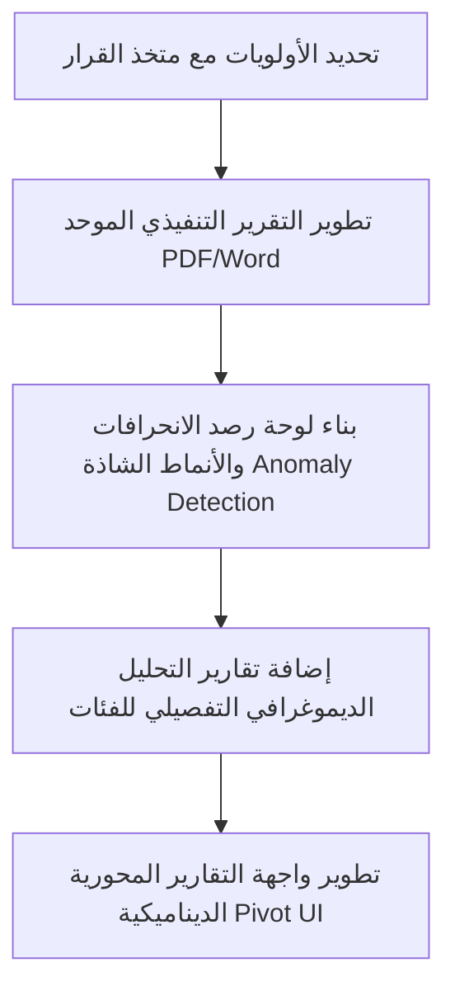

# تقييم وتطوير نظام التقارير والإحصائيات

يحتوي تطبيق **منظومة إحصائيات الأدوية والمستلزمات الطبية** حالياً على بنية تقارير جيدة تغطي الجوانب الأساسية من منصرف وعمليات مقارنة وتكلفة. ومع ذلك، هناك فرصة كبيرة لرفع كفاءة هذا النظام ونقله من مجرد عارض لبيانات الإدخال إلى **نظام ذكاء أعمال (BI) متكامل** يساعد متخذ القرار في التخطيط والرقابة ومنع الهدر.

أدناه تقييم دقيق للنظام الحالي، يليه مقترحات عملية ومحددة لتطوير جزئية التقارير.

---

## 1. الوضع الحالي للتقارير (Current State)

يرتكز النظام حالياً على التقارير التالية:
1. **التحليل الإحصائي العام (Analytical Reports)**: يعرض ملخصات رقمية ومالية للمنصرف من (أدوية تفصيلية، أنسولين، تذاكر طبية 56ب/56ج، أحكام قضائية، مستلزمات، وأدوية مجانية/مدعمة) لفرع/منطقة/عيادة محددة خلال شهر معين.
2. **التقرير المالي (Financial Reports)**: يعرض إجمالي المبالغ المحصلة (حصة المريض)، إجمالي قيمة المنصرف المجاني، المنصرف المدعم (مشاركة الهيئة)، تكلفة المجموعات الدوائية، الأنسولين، المستلزمات والأحكام.
3. **تقرير مقارنة الجهات والفترات (Comparison Reports)**: يقارن صنفاً أو فئة محددة عبر فترات زمنية مختلفة (رصد الاتجاه)، أو يقارن بين جهتين مختلفتين (عيادتين مثلاً) خلال فترة زمنية محددة.
4. **تحليل التكلفة (Cost Analysis)**: يعرض تحليل التكلفة حسب الفئات الدوائية على مدار فترات زمنية محددة مسبقاً (شهر، ربع سنة، سنة) أو مخصصة، مع تحديد الأدوية الأكثر تكلفة.
5. **محور التحليل الزمني المتطور (Temporal Analysis Hub)**: لوحة رسومية متقدمة لعرض تغير المنصرف والاستهلاك التاريخي عبر الشهور مع ميزات التنبؤ البسيط وحساب التحركات الكبرى (Top Movers).
6. **التقارير المتخصصة (Specialized Reports)**: تقارير منفصلة لكل من الأدوية، الأنسولين، التذاكر، الأحكام القضائية، المستلزمات، الأدوية المجانية، الأدوية المدعمة، والمجموعات الدوائية.

---

## 2. الفجوات الحالية ونقاط القصور (Gaps & Limitations)

أبرز الجوانب التي تجعل المستخدم يشعر بقصور جزئية التقارير هي:
* **الجمود وعدم المرونة (Static Dimensioning)**: التقارير تعتمد على جداول ثابتة ومحددة سلفاً. لا يمكن للمستخدم إعادة ترتيب الأعمدة أو اختيار أبعاد مخصصة لعرضها معاً بشكل تفاعلي.
* **غياب التقارير التنفيذية المدمجة (Consolidated Executive Reports)**: إذا رغب متخذ القرار في طباعة ملف واحد شامل يحتوي على ملخص الأداء المالي، والمنصرف العام، وقائمة الأعلى صرفاً، والمقارنات الأساسية في مستند واحد، سيتعين عليه الدخول لعدة شاشات وتوليدها منفردة.
* **ضعف الرقابة ومنع الهدر (Leakage & Fraud Detection)**: لا يحتوي النظام على تقارير ذكية تكتشف التجاوزات أو الأنماط الشاذة في الصرف بشكل تلقائي (مثل عيادة تصرف كميات ضخمة مقارنة بمتوسط العيادات المماثلة، أو وجود فروقات شاذة بين عدد التذاكر وقيمة الدواء المصروف).
* **عدم ربط الأدوية بالمرضى ومعدلات الاستهلاك الفردي**: تقارير الأحكام القضائية والأنسولين تعرض إجماليات ممتازة، ولكن لا توجد تقارير تفصيلية تحلل سلوك الصرف للمرضى ذوي الاستهلاك الكثيف (Super Users) أو مقارنة معدلات الصرف الفعلية بالجرعات المحددة طبياً.
* **قصور التنبؤات المستقبلية**: على الرغم من وجود تنبؤ بسيط في المحور الزمني، إلا أنه لا يخدم التخطيط لطلبيات المخازن المستقبلية وتوقع الشهور الحرجة التي يزداد فيها الطلب على أصناف معينة (موسمية الاستهلاك).

---

## 3. مقترحات للتطوير واستكمال نظام التقارير

نقترح إضافة وتطوير 7 محاور أساسية لترقية جزئية التقارير:

### أولاً: التقرير التنفيذي الموحد (Consolidated Executive PDF/Word Report)
* **الفكرة**: شاشة مخصصة تمكّن المستخدم من إصدار "تقرير الأداء الشهري الشامل" بضغطة زر واحدة.
* **المحتوى**: يقوم النظام خلف الكواليس بجمع بيانات المنصرف العام، والتحليل المالي، وقائمة الأصناف الـ 10 الأكثر استهلاكاً، وأبرز 3 عيادات سجلت نمواً في التكاليف، ويضعها في ملف PDF مصمم بشكل فاخر يحتوي على جداول ورسوم بيانية مدمجة وتوصيات نصية تلقائية.
* **القيمة المضافة**: توفير وقت القيادات الإدارية وتزويدهم بملف إنجاز دوري جاهز للطباعة والتقديم للمجالس الإدارية.

### ثانياً: شاشة التقارير المحورية الديناميكية (Dynamic Pivot Reports)
* **الفكرة**: واجهة مستخدم تفاعلية (Interactive Pivot Grid) تتيح للمستخدم تحديد ما يريد عرضه في الأسطر (مثال: الفروع ثم العيادات) وفي الأعمدة (مثال: السنوات أو الشهور أو الفئات الدوائية)، مع تحديد نوع التجميع (مجموع التكلفة، عدد الحالات، متوسط سعر الوحدة).
* **القيمة المضافة**: تمنح المحللين الماليين حرية كاملة في استخراج أي تقرير غير تقليدي دون الحاجة لكتابة كود برمي جديد.

### ثالثاً: نظام رصد الانحرافات والأنماط الشاذة (Anomaly & Waste Detection Report)
* **الفكرة**: تقرير ذكي يقوم بعمل مسح إحصائي لقاعدة البيانات (Audit & Control) وتحديد الحالات التالية:
  1. **العيادات الشاذة استهلاكياً**: عيادة يرتفع استهلاكها لدواء معين بأكثر من 2 standard deviations عن متوسط استهلاك باقي العيادات لنفس الدواء.
  2. **انحراف التذاكر/التكلفة**: عيادات تسجل انخفاضاً كبيراً في عدد التذاكر الطبية مع ارتفاع ضخم في قيمة الأدوية المصروفة (مما قد يشير إلى صرف أدوية باهظة دون مبرر عددي).
  3. **نمو مفاجئ**: صنف دوائي سجل نمواً بأكثر من 150% بين شهرين متتاليين في منطقة معينة.
* **القيمة المضافة**: أداة رقابية قوية جداً للحد من الهدر المالي والتلاعب في صرف الأدوية.

### رابعاً: تحليلات توقع الاستهلاك وإعادة الطلب (Forecasting & Reorder Advisor)
* **الفكرة**: بالاعتماد على البيانات التاريخية المسجلة، يقوم النظام بحساب:
  1. **التنبؤ الموسمي (Seasonal Trends)**: تحديد الشهور التي تشهد عادة ذروة استهلاك لبعض المجموعات (مثل أدوية الحساسية أو الإنسولين في فصول معينة).
  2. **مستشار الطلبيات (Reorder Advisor)**: بناءً على متوسط استهلاك آخر 3 شهور والتنبؤ، يقترح النظام الكميات المطلوبة لتغطية استهلاك الفترة القادمة (على مستوى الفرع أو المخزن).
* **القيمة المضافة**: الانتقال من مرحلة تسجيل البيانات التاريخية إلى مرحلة التخطيط الاستباقي لمنع نفاد الأصناف الحيوية.

### خامئاً: تقرير المرضى الأكثر استهلاكاً والأحكام القضائية (High-Impact Patients & Judicial Audit)
* **الفكرة**: تقرير خاص بملفات المرضى المستفيدين من الأحكام القضائية والأنسولين يوضح:
  1. توزيع المرضى حسب الفئات العمرية والتشخيصات المرضية الرئيسية (Diagnosis Cluster Analysis).
  2. قائمة المرضى الأكثر كلفة على النظام (Top 50 high-cost patients).
  3. مقارنة الصرف الفعلي للمريض مع الجرعة المقررة له في الحكم القضائي لرصد أي صرف زائد أو تراكمي.
* **القيمة المضافة**: السيطرة الكاملة على بند الأحكام القضائية الذي يمثل عادة عبئاً مالياً كبيراً ومستقلاً.

### سادساً: التوزيع الديموغرافي للفئات المستفيدة (Demographic Distribution Analysis)
* **الفكرة**: بما أن جدول `monthly_drugs_dispensed` يحتوي على تقسيمات واضحة للفئات (طلاب، رضع، هيئة، معيلات)، يقترح النظام تقريراً تحليلياً مخصصاً يوضح:
  1. النسبة المئوية لتوزيع التكلفة بين هذه الفئات على مستوى كل فرع.
  2. تحديد الفئة الأكثر استهلاكاً للأدوية المجانية مقابل الفئة الأكثر استهلاكاً للأدوية المدعمة.
  3. رسم بياني دائري (Pie Chart) يوضح نصيب كل فئة من الميزانية الإجمالية شهرياً وسنوياً.
* **القيمة المضافة**: توضيح الأثر الاجتماعي للتأمين الصحي وتسهيل توجيه الدعم والميزانيات للفئات الأكثر احتياجاً.

### سابعاً: لوحة الرقابة على إغلاق الشهور (Data Lock & Quality Report)
* **الفكرة**: بما أن النظام يحتوي على نظام أقفال (`LockManagementPage` والجدول `locks`) لإغلاق التعديل على البيانات بعد انتهاء الشهر، يُقترح إضافة تقرير جودة البيانات المالي الذي يوضح:
  1. الشهور المفتوحة للتعديل حالياً ونسبة البيانات المكتملة فيها.
  2. تقرير المقارنة بين تاريخ إدخال البيانات الفعلي وتاريخ الصرف المفترض لمعرفة مدى التزام الفروع بجدول الإدخال الزمني (سجل الامتثال للإدخال).
* **القيمة المضافة**: ضمان سلامة ودقة البيانات الإحصائية وصلاحيتها لاعتمادها في التقارير الرسمية دون تعديلات لاحقة غير موثقة.

---

## 4. مسار مقترح للتنفيذ (Roadmap)

للبدء في تطوير هذا الجانب، نقترح السير في خطوات متتالية ومدروسة:

1. **المرحلة الأولى**: إضافة **التقرير التنفيذي الموحد** و**تقرير الفئات المستفيدة (الديموغرافي)** نظراً لسهولة تنفيذهما بالاعتماد على البيانات المتوفرة حالياً في الجداول وتأثيرهما البصري والإداري المباشر.
2. **المرحلة الثانية**: ترقية نظام التنبؤ وبناء **نظام رصد الانحرافات (الانحرافات الشاذة)** في الاستهلاك كأداة رقابية ذكية.
3. **المرحلة الثالثة**: إضافة **الواجهة المحورية الديناميكية** لتوفير أقصى درجات المرونة للمستخدمين المتقدمين.
